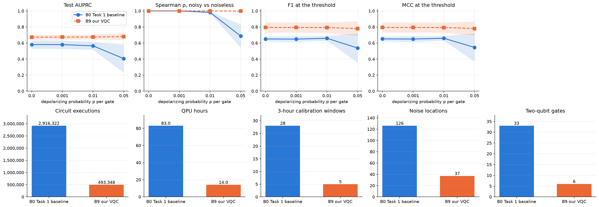

# Fraud on a Quantum Budget

A 4-qubit variational quantum classifier (VQC) that flags fraudulent card payments, keeps its ranking under
depolarizing noise, and needs **83 % fewer circuit executions** than the baseline it started from.

Built for the **BreaQ Hackathon** (October 2026) challenge *Fraud on a Quantum Budget*. The task statement is in
[`data/Fraud on a Quantum Budget - Task.pdf`](data/Fraud%20on%20a%20Quantum%20Budget%20-%20Task.pdf) and the slides
are in [`Fraud on a Quantum Budget (1).pdf`](Fraud%20on%20a%20Quantum%20Budget%20(1).pdf).

## The problem

- **Rare positives.** Only 492 of the 284,807 transactions in the ULB Credit Card Fraud dataset are fraud (0.17 %).
  A model that never flags anything is 99.83 % accurate, so models are ranked by **AUPRC** instead.
- **Noise.** Every gate on real hardware is slightly wrong. The protocol simulates depolarizing noise after every gate
  at p = 0.001, 0.01 and 0.05.
- **Cost.** On a device, every gradient entry costs extra circuit runs (parameter shift: 1 + 2 × parameters per
  example), and every run is repeated for 1,024 shots.

The Task 1 baseline (ZZ feature map + EfficientSU2 ansatz, 32 parameters, 33 CNOTs) does well in clean simulation but
collapses at p = 0.05, and with 1,024 real shots its AUPRC drops to 0.02.

## Results

Full dataset, common stratified 60/20/20 split (`split_indices.npz`), test set of 56,962 transactions (98 frauds),
mean ± std over seeds 0–4. The decision threshold is chosen on validation at the same noise level.

| | B0 Task 1 baseline | **B9 final model** |
|---|---|---|
| Test AUPRC, no noise | 0.580 ± 0.053 | **0.672 ± 0.030** |
| Test AUPRC, p = 0.01 | 0.564 ± 0.049 | **0.675 ± 0.031** |
| Test AUPRC, p = 0.05 | 0.405 ± 0.177 | **0.680 ± 0.044** |
| Test AUPRC, p = 0.05 with 1,024 shots | 0.017 ± 0.016 | **0.641 ± 0.063** |
| Spearman ρ (noisy vs noiseless scores), p = 0.05 | 0.686 ± 0.145 | **0.998 ± 0.003** |
| F1, p = 0.05 | 0.537 ± 0.184 | **0.778 ± 0.092** |
| Trainable circuit parameters | 32 | **7** |
| Gates / CNOTs / depth | 93 / 33 / 45 | **31 / 6 / 21** |
| Noise locations | 126 | **37** |
| Total circuit executions | 2,916,322 | **493,348 (−83 %)** |
| QPU hours (1,024 shots, 10,000 shots/s) | 83.0 | **14.0** |
| 3-hour calibration windows | 28 | **5** |

**Classical reference.** A logistic regression on the same inputs as B9 scores **0.706 ± 0.026**, slightly above the
VQC. This project does not claim a quantum advantage. What it shows is how far a 4-qubit VQC can be pushed towards the
classical reference while holding up under noise and fitting a realistic hardware budget.



Full tables (AUROC, precision, recall, MCC, every noise level) are in
[`results/final/presentation_summary.md`](results/final/presentation_summary.md).

## What changed, step by step

Each step builds on the last one that was kept. Every change was tested on its own, over 5 seeds, against the
previous step and against a logistic regression on the same inputs (development runs use a stratified 30 % sample).

| Step | Change | Effect |
|---|---|---|
| **B1** | Removed the 13 rotations and 3 CNOTs that can never reach the measured qubit (32 → 19 parameters) | Identical model by construction; training executions −40 % |
| **B2** | Validate every 5 epochs on a stratified half of the validation set, instead of every epoch on all of it | Total executions −63 %; quality unchanged |
| **B3** | Angle embedding (one RY per qubit) instead of the ZZ feature map | **Biggest gain.** CNOTs 30 → 6, noise locations 107 → 35, AUPRC at p = 0.05 0.573 → 0.751 |
| **B4** | Rotate the PCA axes so the most fraud-revealing direction lands on the measured qubit | Small test gain that did **not** hold on untouched data; kept only as the base for B5 and B6 |
| **B5** | Trainable readout `sigmoid(a·⟨Z₀⟩ + b)` | Same AUPRC, steadier ranking under noise (ρ 0.946 → 0.976), no extra circuit runs |
| **B6** | Start circuit weights near zero (±0.1) instead of uniform in [0, 2π] | AUPRC +0.02–0.03, seed spread 3× smaller; better on 5 of 5 seeds on untouched data |
| **B9** | Tailored ansatz after Dao (2025, [arXiv:2503.13368](https://arxiv.org/abs/2503.13368)): only the rotations that can change the measured qubit, exp(−iθY_j), exp(−iθY₀Z_j), exp(−iθY₀) | **Final model.** 7 angles instead of 19, same AUPRC as B6 within noise, circuit executions −46 % |

**Tried and dropped:** full-set validation (B2a, same quality, more cost), lighter ZZ feature maps (B3a–c, worse than
angle embedding), a wider ±0.5 initialisation (B6b), an RY-only ansatz with CNOT chains into the readout qubit (B7,
−0.03 to −0.05 AUPRC) and TwoLocal-style trainable CRX gates (B8, −0.05 AUPRC).

The reasoning, costs and measurements behind each idea are in [`task2_upgrades.md`](task2_upgrades.md). Every run is
logged in [`results/task2_results_log.md`](results/task2_results_log.md).

## How the results were checked

- **Fit on training data only.** Scalers, PCA, the discriminative axis and undersampling never see validation or test
  rows. Validation picks epochs and thresholds; the test set is used only for final numbers.
- **AUPRC read together with ρ.** Under noise, the baseline's AUPRC can *rise* while its ranking decays. A gain only
  counts if the Spearman correlation between noisy and noiseless scores stays high.
- **Untouched data.** [`overfitCheck/fresh_holdout.py`](overfitCheck/fresh_holdout.py) scores the development models
  on the 199,365 transactions outside the 30 % sample, which no decision ever used. This is what exposed B4.
- **Finite shots.** [`shot_noise_check.py`](shot_noise_check.py) replaces exact expectation values with binomial
  N-shot estimates, which is what a device measuring qubit 0 actually returns.
- **Why noise barely hurts B9.** [`experiments/noise_vs_interactions.py`](experiments/noise_vs_interactions.py) tests
  why B9's AUPRC creeps up with noise: the noise damps the interaction terms and pushes the score towards the
  discriminative axis that the logistic regression uses.

## Repository layout

```
task1_guided_vqc_fraud_detection.ipynb   Task 1: guided end-to-end VQC pipeline (the B0 baseline)
task2_vqc_fraud_detection.py             Task 2: every model B0–B9, the evaluation protocol and the cost ledger
final_run.py                             Final B0 vs B9 run on the full common split → results/final/
shot_noise_check.py                      AUPRC with finite shots on top of gate noise
overfitCheck/fresh_holdout.py            Scores models on data outside the development sample
experiments/                             B7, B8/B9 ansatz tests and the noise-vs-interactions analysis
task2_upgrades.md                        Design notes: what to change, why, and what it cost
results/                                 Logs, per-model protocol CSVs and comparison figures
split_indices.npz                        The common 60/20/20 split (seed 42)
```

## Running it

```bash
python3 -m venv .venv
.venv/bin/python -m pip install -r requirements.txt

.venv/bin/python task2_vqc_fraud_detection.py   # development runs (SAMPLE_FRACTION = 0.3)
.venv/bin/python final_run.py                   # final B0 vs B9 results on the full split
```

The dataset (150 MB) is not in the repository. When `data/creditcard.csv` is missing, the code downloads the
identical [OpenML dataset 42175](https://www.openml.org/d/42175) automatically. Built with PennyLane 0.45, PyTorch
and scikit-learn; exact versions are pinned in `requirements.txt`.

## Limitations

- Depolarizing noise only: no readout or amplitude-damping errors.
- Training uses exact gradients in simulation. On hardware, the gradients would also carry shot noise.
- Part of the common test set overlaps with the 30 % development sample. The untouched-data check covers that gap
  for model selection.

## References

- Dinuț et al. (2026): the quantum kernel SVM and VQC study on this dataset that the challenge starts from.
- Dao (2025), *Exploring new variational quantum circuit ansatzes for solving SU(2) matrix models*,
  [arXiv:2503.13368](https://arxiv.org/abs/2503.13368).
- Dal Pozzolo et al. (2015): the ULB Credit Card Fraud dataset.
